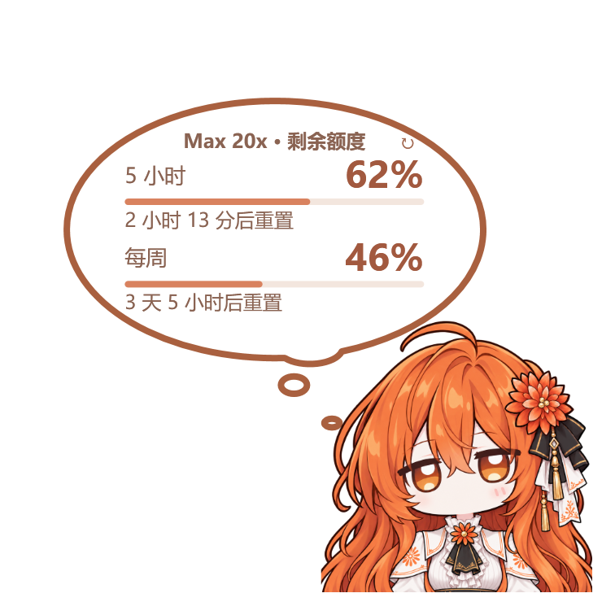

# Claude 娘 · Claude 桌面端额度挂件

在 Windows 上给 Claude 桌面端放一个小角色。点她查看剩余额度和重置时间，点气泡翻页或看语录；播放音乐时，还能让她戴上墨镜、跟着节拍跳动。

**[下载 Windows 版](https://github.com/Gryphus-Triune/Claude-Niang/releases/latest)** · [安装说明](#下载与安装) · [常见问题](#常见问题) · [反馈问题](https://github.com/Gryphus-Triune/Claude-Niang/issues/new/choose)

- **手动读取额度**：由你点击查询，启动、恢复窗口、登录完成和自动语录都不会后台查询。
- **看得见数据时间**：展示上次读取时间，过了重置时间会提示等待刷新。
- **自己的桌面角色**：支持换形象、语录、点击音效和音乐律动。
- **可选对话扩展**：在 Claude 对话里询问额度，或明确要求刷新。
- **更容易排查**：挂件运行期间会尝试恢复意外退出的监督进程，并在本机保存诊断日志。

适用于 Windows，需 Node.js 20 或更新及 WebView2。读取额度本身不调用模型，无需 API Key。**非 Anthropic 官方产品。**

 

*程序原生界面预览，额度为示例数据；实际额度窗口由账号和组织提供的信息决定。*

## 可以做什么

| 功能 | 使用方式 |
|---|---|
| 套餐与额度 | 查看套餐、5 小时额度、每周额度、分模型每周额度、额外用量和重置时间；以接口实际提供的窗口为准。 |
| 数据时间与提醒 | 显示上次更新时间；手动读到新结果后判断低额度和重置提醒。 |
| 形象与语录 | 拖动、缩放角色，导入自己的图片，编辑语录和点击音效。 |
| 音乐律动 | 在本机分析正在播放的声音，跟随节拍跳动；默认形象会戴上墨镜。 |
| Claude 对话扩展 | 询问本机保存的额度，明确说“刷新额度”时发起一次新读取。 |

Free 或部分组织可能没有额度窗口；挂件无法提供接口没有返回的数据。今日观测统计是本机采样估算，不是完整账单、消息数或 token 数。

## 下载与安装

**当前程序版本：1.3.2**。

1. 打开 **[最新版发布页](https://github.com/Gryphus-Triune/Claude-Niang/releases/latest)**，在 Assets 中下载 `claude-niang-v版本号-windows.zip`。同名 `.sha256` 用于校验下载内容，普通安装不需要它；GitHub 自动生成的 `Source code` 归档供开发者使用。
2. **完整解压**到以后不会移动的文件夹，例如 `%LOCALAPPDATA%\Programs\Claude娘额度挂件`。不要在压缩包里直接运行。
3. 双击 **安装Claude娘.cmd**，按提示检查依赖并在 Claude 娘自己的登录窗口中登录 claude.ai。安装不需要管理员权限。
4. 打开 Claude 桌面端主窗口，点右下角的角色或 **↻**，读取第一次额度。

安装器会登记当前用户的开机自启；计划任务不可用时改用“启动”文件夹。安装后移动文件夹，请按下方的“搬家”步骤重新登记。

安装前需要准备什么

| 项目 | 要求与兼容性 |
|---|---|
| 系统 | 面向 Windows 10 / 11，提供 x64 和 ARM64 所需组件。macOS / Linux 不支持。 |
| Claude | 已安装 Claude 桌面端。官网安装版和微软商店版均为适配目标。 |
| Node.js | 20 或更新，建议安装 [Node.js 官网的 LTS 版](https://nodejs.org/)。安装器会在 PATH 和常见安装位置里查找。 |
| WebView2 | Microsoft Edge WebView2 运行时。缺少时安装器会给出[微软官方下载入口](https://developer.microsoft.com/microsoft-edge/webview2/)。 |
| 账号 | 能登录 claude.ai 的账号。Free 或部分组织可能不提供额度窗口。 |

Windows 10、ARM64、微软商店版 Claude、多屏和混合 DPI 仍需更多实机反馈；上述适配目标不表示每种环境都已验证通过。

下载标记、Windows 提示和登录问题

可以在解压前右键 ZIP → **属性** → 勾选 **解除锁定** → 确定。安装器也会清除程序文件夹内的下载标记，帮助加载 WebView2 组件。

如果 Windows 显示“Windows 已保护你的电脑”，请先确认文件来自本仓库发布页并核对校验值，再决定是否运行。

用 Google 登录时如果提示浏览器不安全，可以改用 **Continue with email**，按页面提示用邮箱验证码登录。需要人机验证时，请在登录窗口里自己完成。

**挂件的登录和 Claude 桌面端是分开的。**两边登录不同账号时，挂件显示的是自己登录的账号；有多个组织时，可以在右键菜单里切换。

## 日常使用

| 操作 | 效果 |
|---|---|
| 点角色 | 展开额度气泡并读取一次。同一组织 15 秒内的重复点击复用刚才的结果，同时发出的多个请求合并为一次读取。 |
| 点气泡 | 下一页 → 语录 → 收起。 |
| 点 ↻ 或右键“刷新额度” | 手动刷新额度。 |
| 右键 → Claude 账号 → 切换组织 | 读取选定组织，切换时先隐藏旧组织的额度。 |
| 鼠标停在气泡上 | 查看组织、时间、金额和完整说明。 |

气泡会标出上次更新时间。断网或接口变化时保留上次成功的数据；已到重置时间但还没重新读取时，会提示等待刷新。当前界面与缓存仍可能保留上次读取的信息，请结合数据时间判断。

连续 3 次读取失败后暂停 30 秒，状态栏会提示剩余等待时间；暂停结束不会自动重试。读取成功、重新登录或切换组织后重新计数。低额度和重置提醒只在手动读取到新结果后判断，不会为了提醒去后台查询。

“今日观测统计”从本机当天第一次成功读取起，累计观察到的每周额度增量，单位是百分点；统计按组织区分。

文件夹里的几个启动入口

| 文件 | 作用 |
|---|---|
| 安装Claude娘.cmd | 安装，或在原位置重新登记挂件。 |
| 打开Claude娘.cmd | 手动启动挂件，不会因此读取额度。 |
| 登录Claude账号.cmd | 打开挂件自己的登录窗口。 |
| 检测套餐.cmd | 主动读取一次，用于排查套餐和额度。 |
| 停用Claude娘.cmd | 关闭挂件并移除开机自启，保留文件、设置和登录。 |

## 在 Claude 对话里问额度

这是**可选扩展**，不影响挂件的日常使用。

先安装并打开挂件，在挂件里登录并读取一次额度。然后双击完整发布包中的 `Claude桌面扩展\claude-niang-usage.mcpb`，在 Claude 桌面端里安装扩展。最新版发布页也提供单独的 `.mcpb`；它不能代替挂件本身。

问“我还剩多少额度？”时，扩展读取本机保存的快照，并告诉你数据时间；明确说“刷新额度”时，才让正在运行的挂件重新读取。挂件未运行时，扩展会说明刷新未成功，并尽量给出上次保存的数据。

扩展自身不会创建聊天或调用模型，也接触不到登录 Cookie。数据目录一般不用改；如果自定义了挂件数据位置，在扩展设置里选择对应的 `state` 文件夹。

## 换形象、语录、音效和音乐律动

- **形象**：右键 → 更换形象 → 添加形象。建议透明背景的正方形 PNG，大头半身、角色撑满画布，1024～2048 像素；上限为边长 4096、文件 20 MB。
- **语录**：右键 → 编辑我的语录，一行一句；也可以恢复内置语录，或在“自动语录”里定时显示。
- **音效**：右键 → 声音与点击，可以导入最长 5 秒的 WAV，导入后会转成本地缓存。
- **音乐律动**：右键 → 音乐律动。角色跟随电脑正在播放的声音跳动，两边出现音箱，窗口上方挂一个灯球，还可以把她拎起来甩出去。声音只在本机分析，不保存也不上传。
- **墨镜**：音乐律动时默认形象会戴上墨镜；自行导入的形象默认不戴墨镜。

形象资源和墨镜标定的开发说明见 [自定义资源说明](docs/customization.md)。

## 更新、搬家与卸载

**更新**：先运行“停用Claude娘.cmd”，将新版本覆盖到**同一个文件夹**，保留原有 `claude-niang\installation.json`，再运行“安装Claude娘.cmd”。设置和登录保存在程序文件夹之外。如果装过桌面扩展，再双击一次新的 `.mcpb` 更新。

**搬家**：先运行“停用Claude娘.cmd”，再把整个文件夹移到新位置并重新安装。避免同时保留两个已安装的副本，它们会争用同一份开机启动登记。

**彻底卸载**：先运行“停用Claude娘.cmd”，再删除程序文件夹和 `%LOCALAPPDATA%\ClaudeNiang`；后者包含挂件自己的登录、设置和数据。桌面扩展请在 Claude 桌面端的设置里移除。

## 数据与隐私

- 每个 Windows 用户使用自己的登录、设置和数据。登录保存在 `%LOCALAPPDATA%\ClaudeNiang\webview`；额度快照、设置和统计保存在旁边的 `state`。
- 诊断日志保存在 `%LOCALAPPDATA%\ClaudeNiang\state\logs\claude-niang.log`，用于记录运行状态和错误；反馈前请检查并去除个人信息。超过 1 MB 时会保留一份旧日志。
- 挂件不读取常用浏览器或 Claude 桌面端里的登录，也不把 Cookie 交给 Node.js 部分或桌面扩展。
- 读取额度时访问 claude.ai 的组织、用量、必要的套餐信息和余额接口；组织和余额会缓存，减少重复请求。
- 没有自动更新、遥测或第三方上传。音乐分析也只在本机进行。

claude.ai 的网页接口不是公开 API，随时可能变化而失效。请遵守 Anthropic 的服务条款；遇到限流、验证或账号不可用时，挂件会提示原因，并等你下一次操作。

## 常见问题

| 问题 | 处理方法 |
|---|---|
| 挂件没有出现 | 打开 Claude 主窗口、取消最小化，再双击“打开Claude娘.cmd”。 |
| 没有额度数字 | 在挂件里登录，再点角色或 ↻。Free 等套餐没有额度窗口时会有说明。 |
| 显示的账号或额度与桌面端不同 | 检查挂件自己的登录账号和右键菜单中的组织。两边登录相互独立。 |
| 内置浏览器组件检查失败 | 重新运行“安装Claude娘.cmd”；仍失败时检查 WebView2 运行时。 |
| 提示“已连续失败 3 次” | 等待提示的秒数后再点 ↻，并检查网络、验证或登录状态。 |
| 已限流 | 按提示等待后手动刷新，程序不会定时重试。 |
| 退出登录失败 | 先关闭已打开的登录窗口，或等当前查询结束后再试。 |
| 安装失败 | 查看程序文件夹 `claude-niang` 内的 `install-log.txt`。 |
| 旧版开机后出现空白 PowerShell 窗口 | 更新后双击一次“打开Claude娘.cmd”，重新登记隐藏启动。 |
| 挂件消失、读取持续失败或音乐律动停止 | 查看 `%LOCALAPPDATA%\ClaudeNiang\state\logs\claude-niang.log`。 |

仍有问题，请[提交反馈](https://github.com/Gryphus-Triune/Claude-Niang/issues/new/choose)，附上挂件版本、Windows 与 Node.js 版本、复现步骤及错误提示。发布日志前请去掉用户名、个人路径、邮箱和组织信息，勿上传 Cookie、登录文件或浏览器配置目录。

## 开发与贡献

测试、构建和干净打包的方法见 [CONTRIBUTING.md](CONTRIBUTING.md)。工作流配置在 `.github/workflows/ci.yml`；实际运行结果以 [GitHub Actions](https://github.com/Gryphus-Triune/Claude-Niang/actions) 为准。

## 许可与致谢

基于 [GPT 娘 1.3.5](https://github.com/T7moris/GPT-Niang)（MIT）改写，借鉴了[小鲸鱼余额挂件](https://github.com/MeteorNOX/DeepSeek-Balance-Whale-Widget)的提醒与记账思路。内置语录中有 7 句来自该项目，来源与许可见 [语录许可说明](claude-niang/assets/quotes-LICENSE.txt)。

源代码、内置语录和点击音效遵循 [MIT License](LICENSE)，保留 GPT 娘原作者和贡献者的署名。默认形象图片（`claude-niang/assets/claude-niang.png`）和由它做成的扩展图标版权归仓库作者所有，不在 MIT 许可范围内。WebView2 文件遵循微软自己的许可，见 `claude-niang/runtime/webview2/LICENSE.txt` 与 `NOTICE.txt`。

Claude 是 Anthropic 的商标。本项目与 Anthropic 没有关联。
